<p align="center">
  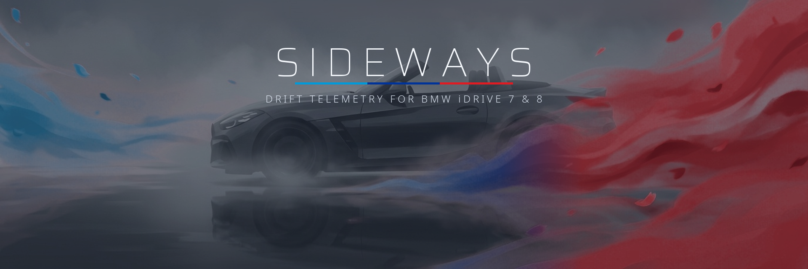
</p>

<p align="center">
  <a href="https://github.com/idrive-labs/sideways/releases/latest"></a>
  
  <a href="https://github.com/idrive-labs/mgu-apps"></a>
</p>

<p align="center">
  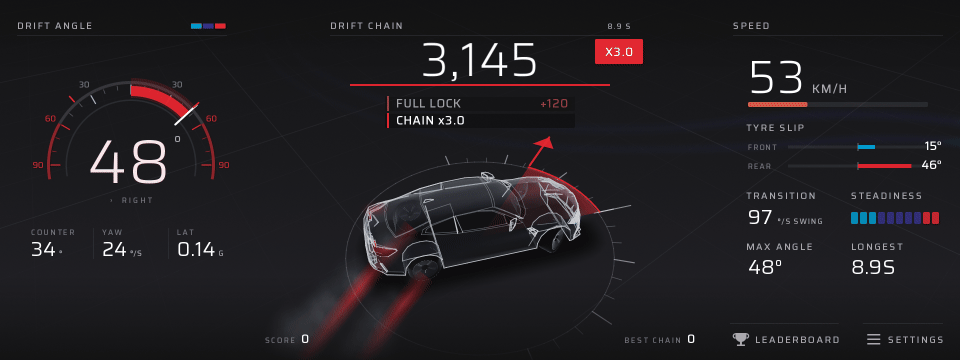
</p>

<p align="center"><b>Your BMW's centre display, turned into a drift telemetry screen.</b><br>
It runs on the car's own sensors and needs no extra hardware or coding. It scores every chain,<br>and the best ones go on a worldwide leaderboard.</p>

<p align="center">
  <b><a href="#install">Install</a></b> &nbsp;·&nbsp; <b><a href="#how-scoring-works">Scoring</a></b> &nbsp;·&nbsp; <b><a href="#the-leaderboard">Leaderboard</a></b> &nbsp;·&nbsp; <b><a href="#faq">FAQ</a></b>
</p>

> [!TIP]
> **Sideways is in beta, and it needs drivers.** Try it on your car and
> [tell us how it drifts](https://github.com/idrive-labs/sideways/discussions/1): your car, what
> worked, what you'd love next. Every reply shapes the next version.

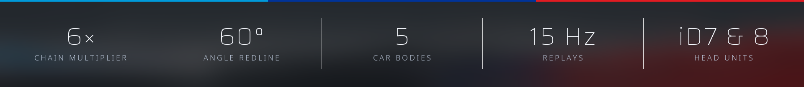

<br>

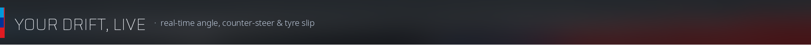

The drift angle comes straight from the car: yaw rate, lateral and longitudinal acceleration, the
steering angle and all four wheel speeds. You see it while you hold it, with counter-steer, tyre
slip front and rear, and how fast and how steady your transitions are. The chain builds at the
top of the screen, and every clean transition pushes the multiplier further.

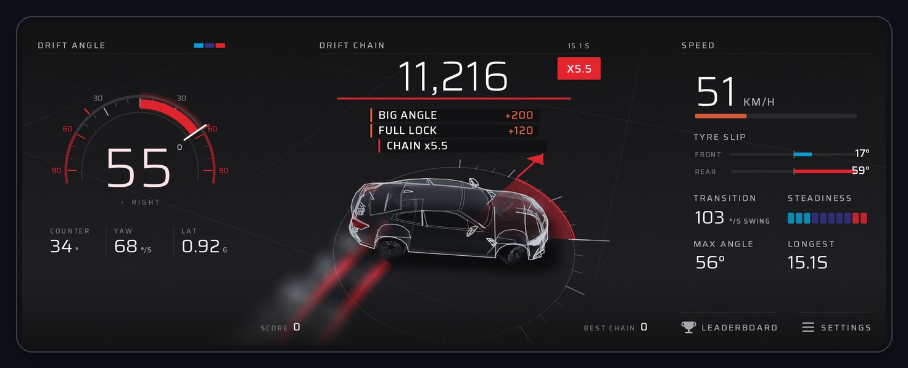

<table>
  <tr>
    <td width="33%" align="center">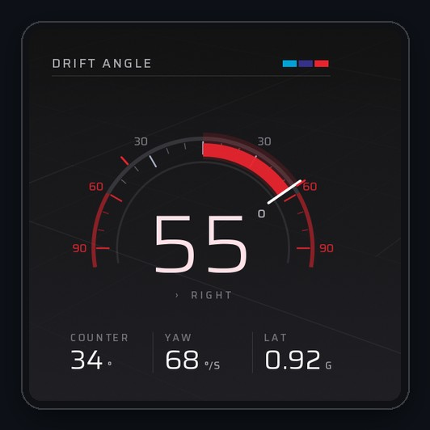<br><sub><b>THE DIAL</b> · 60° redline, peaks both ways</sub></td>
    <td width="34%" align="center">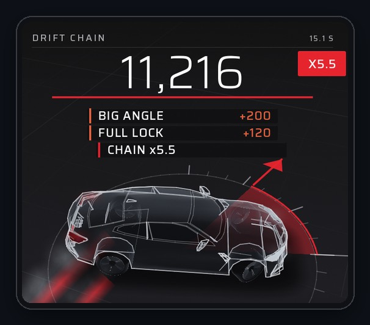<br><sub><b>THE CHAIN</b> · bonuses as you earn them</sub></td>
    <td width="33%" align="center">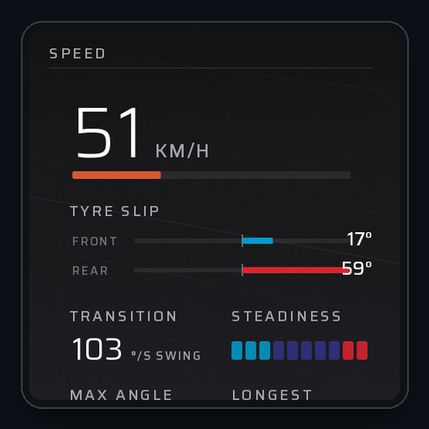<br><sub><b>THE CAR</b> · tyre slip, transitions</sub></td>
  </tr>
</table>

<a name="the-leaderboard"></a>
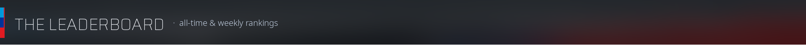

All time and this week: the top 20 drivers, and your own place among everyone beneath them,
whether that is #4 or #12,345. Every ranked drift comes with its replay, so tap ▶ and see how
it was done.

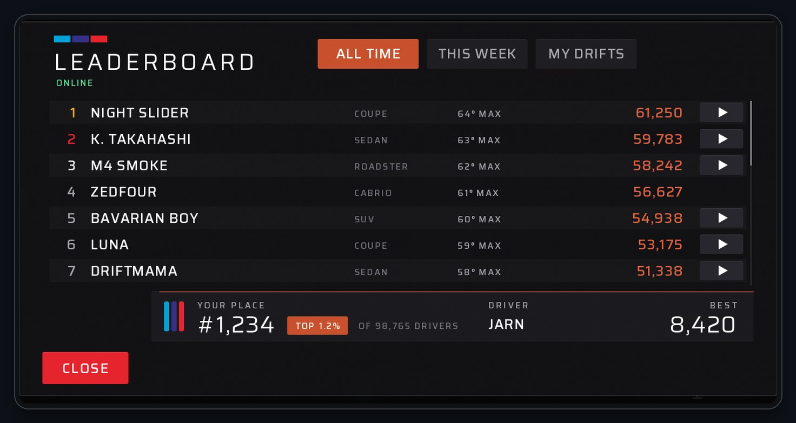

<p align="center">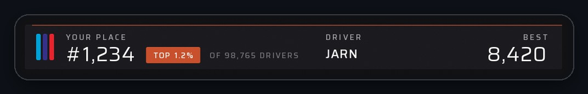<br>
<sub><b>YOUR PLACE</b> · always there under the top 20, however far down the world you are</sub></p>

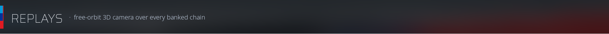

Every drift you bank is kept. Watch it from the chase camera, from above, or go **freestyle**:
drag to orbit round the car and zoom with + and −, while it plays or paused.

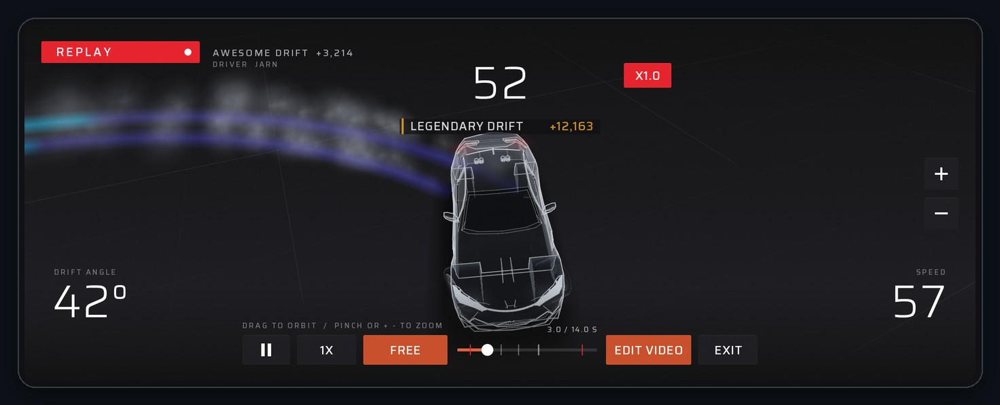

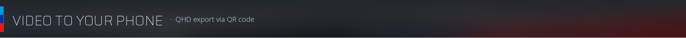

Choose the format (16:9, 9:16 for stories, or 1:1), the camera, slow motion at the peak and the
overlay. Then scan the code: your phone makes the video and saves it, and the link deletes itself.

<table>
  <tr>
    <td width="72%" valign="middle">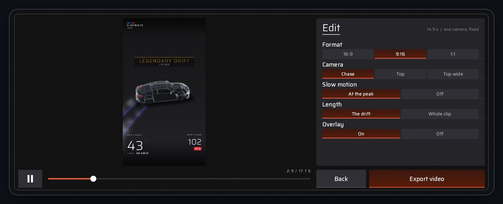<br><sub><b>EDIT</b> · format, camera, slow motion, overlay</sub></td>
    <td width="28%" valign="middle" align="center">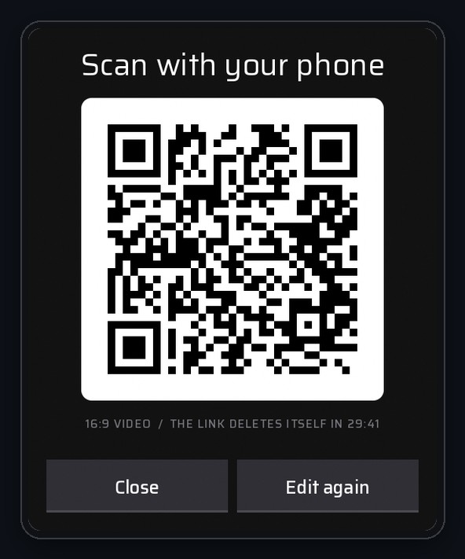<br><sub><b>SCAN</b> · made on your phone</sub></td>
  </tr>
</table>

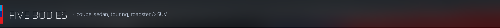

Sideways picks the iDrive 7 or iDrive 8 design by itself from your car. Its five bodies (coupe,
sedan, cabrio, roadster, SUV) are matched to your car's type. Every screen opens as a popup over
the drive.

<table>
  <tr>
    <td width="50%">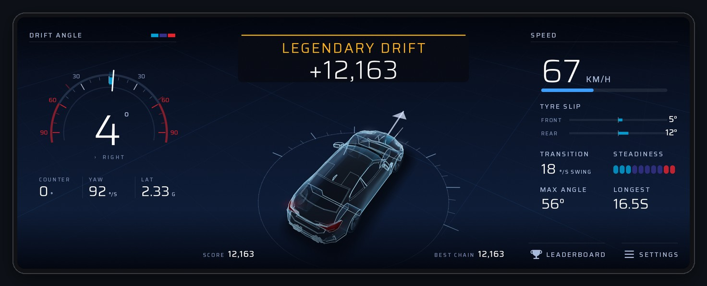</td>
    <td width="50%">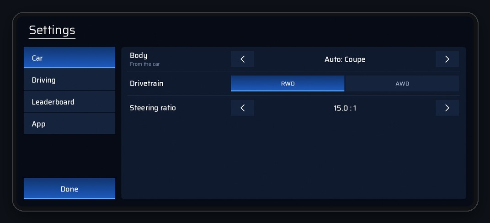</td>
  </tr>
</table>

<a name="install"></a>
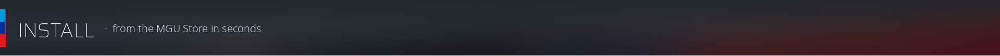

You need a BMW with an **iDrive 7 (MGU)** or **iDrive 8** head unit, with root access and the
[MGU Store](https://github.com/robertnisipeanu/mgu-store). For the leaderboard and the videos,
the car needs internet: its own, or a phone hotspot.

1. In the Store: **Settings → Add source**, type **`idrive-labs/mgu-apps`**, and choose **Releases**.
2. Install **Sideways**. Updates arrive by themselves.

Then drive a few normal corners: Sideways learns your car's signals, and once *Calibrating* is
gone from the screen it is live.

<details>
<summary>By hand, with the idrive7-apps kit</summary>

Download `sideways-<version>-kit.zip` from [Releases](https://github.com/idrive-labs/sideways/releases/latest)
and unzip it into the kit as `apps/sideways`. Then `python3 kit/tools/build.py sideways`, and push
it to the car the kit's way.
</details>

<a name="how-scoring-works"></a>


| | |
|---|---|
| **Drifting** | angle ≥ 10° above 20 km/h. Points flow from angle × speed, more when the angle is held steady. |
| **Chain** | drifts link through transitions and short moments of grip (1.4 s of grace). |
| **Multiplier** | +0.5 every 2.5 s of drifting and on every clean transition, up to **×6**. |
| **Bonuses** | Transition · Big angle (> 50° for 1 s) · Speed drift (> 80 km/h) · Long drift (each 6 s) · Smooth (3 s steady) · Full lock |
| **Banked** | when the grace runs out: points × multiplier. A spin (over 110°) or a stop loses the chain. |
| **Ratings** | Nice · Great **800** · Awesome **2,500** · Insane **6,000** · Legendary **12,000** · Godlike **25,000** |


- **One driver per car.** The account belongs to the car. Remove the app and install it again,
  and your name and drifts come back by themselves.
- **Your name is yours.** It is unique (in any case), and you can change it once a day.
- **Only real drives count.** Nobody can post drifts as you, and only drifts driven in a car
  reach the board.
- **Nothing is lost.** Drifts driven offline wait on the car and are sent later. Cheaters are
  banned.

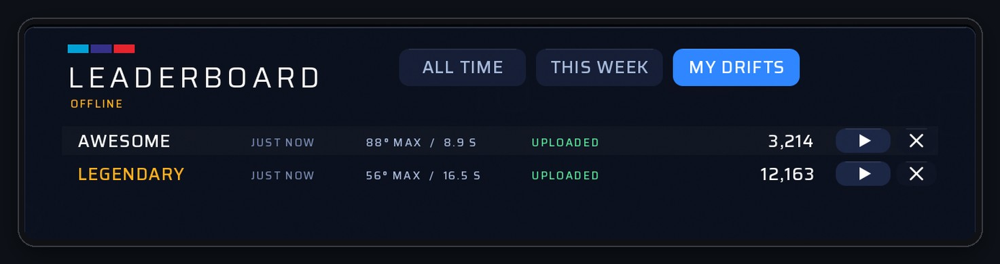

> [!WARNING]
> Drift only on closed ground: a track day or a closed course. Sideways is an unofficial hobby
> project, not affiliated with or endorsed by BMW AG.

## FAQ

<details>
<summary><b>Does it change anything in my car?</b></summary>

No. Sideways only **reads** signals the head unit already has. It codes nothing and
writes nothing to any control unit.
</details>

<details>
<summary><b>What does it send, and to whom?</b></summary>

It sends your driver name and, for each banked drift, its numbers and its replay to the
leaderboard. The replay holds the car's motion and the scoring at 15 Hz, in a local frame, with
**no GPS position**. Your car is known only by an anonymous ID. There is no location, no
contacts and no other vehicle data. The leaderboard runs on Cloudflare (EU database).
</details>

<details>
<summary><b>Does it work without internet?</b></summary>

Yes. The drift angle, the scoring, your history and the replays all work offline. The leaderboard
and the video export need a connection, and drifts wait on the car until there is one.
</details>

<details>
<summary><b>Which cars?</b></summary>

Any BMW with an iDrive 7 (MGU) or iDrive 8 head unit that runs the community app platform. The drift angle needs the car's yaw rate,
accelerations, steering angle and wheel speeds, which these head units have.
</details>

<details>
<summary><b>I found a bug / I have an idea</b></summary>

Open an [issue](https://github.com/idrive-labs/sideways/issues). Say which car and head unit it
is (for example *G82, iDrive 7*), and what you did and saw.
</details>

## Building from source

```sh
./tools/make_kit_app.sh        # -> dist/sideways, the app folder for the kit
```

It needs Node.js and Python 3. The head unit runs Node 8, so the code keeps to what Node 8 has.

## Licence

Sideways is free software under **GPL-3.0-or-later** (see `LICENSE`). Third-party parts:

- The renderer, mgu-render, is by Robert Nisipeanu and IterioDev (GPL).
- The font is Saira (SIL Open Font License 1.1).
- Third-party licences and credits: `CREDITS.md`.

---

<p align="center">
  <sub>Built for fun by <a href="https://github.com/jarnesence">Járn</a> · <a href="https://github.com/idrive-labs">iDrive Labs</a> · Unofficial hobby project, not affiliated with BMW AG.</sub>
</p>
